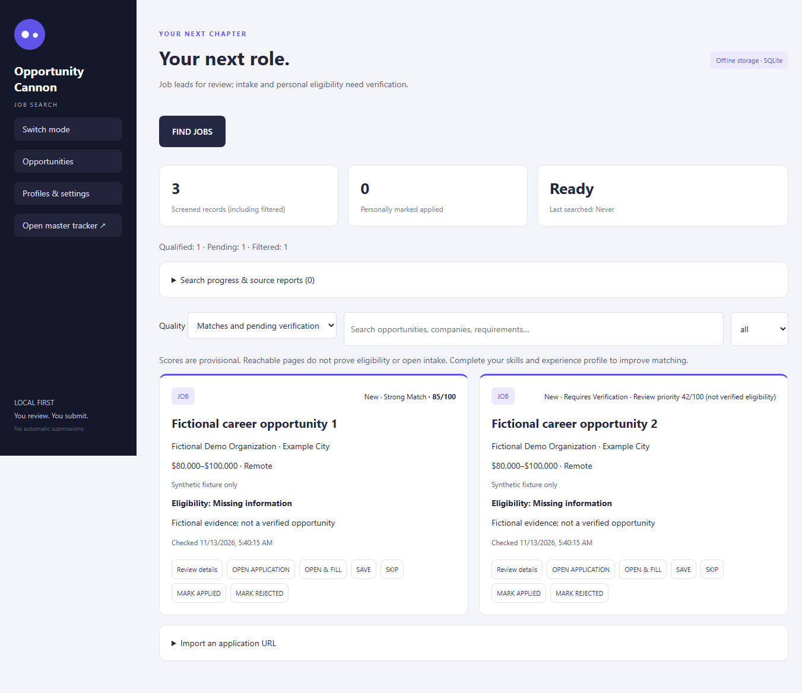

# Opportunity Cannon 0.3.1

[](https://github.com/NukeItGames/OpportunityCannon-Portfolio/actions/workflows/validate.yml)

A Windows desktop app for researching jobs and startup funding, reviewing matches, and tracking applications. Built with **Electron, React, and TypeScript**.

**[Download for Windows](https://github.com/NukeItGames/OpportunityCannon-Portfolio/releases/tag/v0.3.1)** · [Demo](docs/DEMO.md) · [Build & usage guide](docs/GUIDE.md)

## What it does

- Discovers public job and funding sources automatically.
- Filters and ranks leads using your profile.
- Tracks status, notes, and application history.
- Protects Applied and Rejected records from duplicate applications.
- Fills supported Chrome/Edge form fields. You review and submit.
- Stores data locally with SQLite, Windows DPAPI, and encrypted backups.



*Actual Windows build. All displayed records and salary values are fictional.*

## Get started

Download the **unsigned Windows x64 installer**, install, and launch the app. Create your profile, choose Job Search or VC Funding, then search and review the results. Missing evidence stays **Requires Verification**.

[Installation, browser setup, and backup instructions →](docs/GUIDE.md)

## Technology

Electron · React · TypeScript · SQLite · C# native host · Chrome/Edge Manifest V3 · Vite · esbuild · Windows NSIS

<details>
<summary>Build from source</summary>

Requires Windows x64, Node.js 24, and the .NET Framework C# compiler.

```powershell
cd desktop
npm ci
node node_modules/electron/install.js
npm run build
npm test
npx tsc --noEmit
npm start
```

Create the unsigned installer with `npm run package`.

</details>

## Validation

**63 automated tests, seven desktop suites, ten UI checks, and the Windows NSIS build passed.** [Results and test scope →](docs/VALIDATION.md)

Installation lifecycle, Chrome popup, native handoff, and live integrations remain unverified.

[Privacy](docs/PRIVACY.md) · [Third-party notices](THIRD_PARTY_NOTICES.md) · [License](LICENSE)
