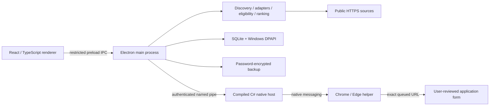

# Opportunity Cannon 0.3.1

[](https://github.com/NukeItGames/OpportunityCannon-Portfolio/actions/workflows/validate.yml)

A Windows desktop workspace for researching jobs and funding opportunities, reviewing fit, and keeping application decisions in one place. Built with Electron, React, and TypeScript. Applications remain a human decision: the app never submits them for you.

This portfolio edition starts from the verified 0.3.1 source. It contains the functional desktop application, browser helper, native host, and automated tests, with fresh Git history and no personal profiles or application records.


Genuine capture from the extracted Windows build. All displayed opportunities, scores, organizations, and salary values are synthetic UI fixtures. See the [funding workspace, onboarding, and browser helper](docs/DEMO.md).

## What it does

- **Job and funding research:** separate Job Search and VC Funding workspaces, with automatic public-source discovery and editable custom sources. Adapters support Greenhouse, Lever, Ashby, readable JobPosting pages, and funding application pages.
- **Profile-based review:** explicit role, location, sector, stage, and eligibility preferences inform filtering and ranking. Missing evidence stays **Requires Verification**; a priority score is not proof of eligibility.
- **Application workflow:** save opportunities, add notes, track Applied and Rejected decisions, and retain status history across restart and rediscovery.
- **Duplicate protection:** canonical URLs, known ATS aliases, and observed redirects reconcile records while preserving protected decisions. Reopening requires explicit review; unknown URL relationships remain unverified.
- **Browser integration:** an optional Chrome/Edge extension fills supported blank fields using answers the user supplied. It preserves existing answers and leaves uploads, CAPTCHA, consent, and submission to the user.
- **Local storage:** SQLite stores research and history. Electron safeStorage uses Windows DPAPI for record bodies and a separate credential vault. Metadata such as IDs, timestamps, and status-history fields remains readable.
- **Portable encrypted backups:** AES-256-GCM with a scrypt-derived password key, import preview, and merge protection. Credentials and browser delivery tasks are excluded.

Research uses implemented adapters and deterministic matching. This project does not claim autonomous-agent behavior. An optional, explicitly authorized provider API path exists in the source; live AI, Google OAuth, and Sheets integrations are outside the portfolio validation unless specifically recorded in [validation](docs/VALIDATION.md).

## Architecture



The renderer runs with context isolation, sandboxing, and no Node integration. The main process owns storage, networking, validation, and IPC. `electron/core.ts` reconciles opportunity identities and protected history; `discovery.ts` and `search.ts` find and normalize sources; `profiles.ts`, `preferences.ts`, `eligibility.ts`, and `ranking.ts` handle user choices and review evidence. The Manifest V3 extension and .NET Framework native host deliver short-lived, single-use tasks without placing answers in URLs.

| Layer | Technology |
|---|---|
| Desktop and interface | Electron 42, React 19, TypeScript 5, CSS |
| Research and data | Cheerio, Undici, Node SQLite, Windows DPAPI |
| Browser delivery | Manifest V3, Chrome/Edge native messaging, C#/.NET Framework |
| Build and distribution | Vite 6, esbuild, electron-builder 26, Windows NSIS |
| Verification | Node test runner through tsx, Playwright, GitHub Actions |

## Build and run

Use Windows x64, Node.js 24, npm, and the Windows .NET Framework C# compiler. From the repository root:

```powershell
cd desktop
npm ci
node node_modules/electron/install.js
npm run build
npm test
npx tsc --noEmit
npm start
```

`npm run package` builds the unsigned NSIS installer at `desktop/release-0.3.1/Opportunity Cannon Setup 0.3.1.exe`. Installed users do not need Node.js. Distribution downloads appear under [Releases](https://github.com/NukeItGames/OpportunityCannon-Portfolio/releases); successful Windows CI builds also provide an installer artifact on the [Actions page](https://github.com/NukeItGames/OpportunityCannon-Portfolio/actions). Availability and test evidence are recorded in [validation](docs/VALIDATION.md); a build is not an installation lifecycle test. No code-signing certificate is included.

For a downloaded installer, run `Opportunity Cannon Setup 0.3.1.exe` on Windows x64, choose a per-user installation directory, then launch Opportunity Cannon from the Start menu. The installer is unsigned and has no verified code-signing publisher. Interactive installation, upgrade, and uninstall have not been exercised in this portfolio run.

Portable unit tests and TypeScript checks also run on Linux. The full build calls PowerShell and the Windows compiler; the desktop runtime requires its Windows native host and secure storage.

## First use

1. Complete or skip the optional shared contact, Job Search, and VC Funding profile sections. Fresh fields, source lists, and history start empty.
2. Enter your research preferences, save, and choose Search. Review each source, official application URL, current intake, and eligibility before acting.
3. Save records and notes as you work. Personally submit through the official site, then mark Applied. Applied and Rejected records are protected from accidental reuse.
4. In Profiles & settings, export a password-encrypted backup. Use at least 12 characters and keep the password separately. Import previews preserve existing records; copy referenced documents separately.

For a reproducible fictional walkthrough and screenshots, see [the demo](docs/DEMO.md). No real applications are used by the demo.

## Browser helper

After a normal Windows installation, choose **Open extension folder** in settings. In `chrome://extensions` or `edge://extensions`, enable Developer mode and **Load unpacked** from that folder. Pin the helper, open its popup, and choose **Enable HTTPS access & reconnect**. Keep the installed folder in place. Managed browsers can restrict these steps.

Use that Chrome/Edge installation as your default HTTPS browser, keep the app open, and choose **Verify browser connection**. Review an official URL and use **OPEN & FILL**. Inspect every answer and submit manually. The helper supports common text fields, exact native options, and explicit non-consent choices. It does not attach files, click site buttons, bypass login, or fill unknown answers. A different form URL needs a fresh authorized task. Tasks expire after 15 minutes; create a new one after an interrupted delivery.

## Privacy and limitations

Automatic discovery sends selected high-level profession/sector, location, industry, and stage preferences to DuckDuckGo. It does not send contact details, resumes, or private eligibility answers. Disable discovery in settings if desired. Source coverage depends on indexing, language, page structure, and provider availability; restricted or dynamic pages can fail.

DPAPI binds local encryption to the Windows account and does not protect against software running as that account. Backups contain sensitive profile/history data even though encrypted. Lost backup passwords cannot be recovered. Uninstall configuration preserves app data. The internal package name and `com.nukeitgames.opportunitycannon` are retained publisher/compatibility identifiers.

Data is stored under `%APPDATA%/peopleping-opportunity-cannon/`, outside the installation directory. Local record encryption is not whole-database encryption; selected metadata remains readable.

## Validation

The portfolio Windows and Linux jobs passed all **63 baseline tests** and TypeScript checks. The Windows production/NSIS build, **seven desktop acceptance suites**, and **ten final UI checks** passed, including fictional onboarding, encrypted storage, backup/restore, protected application history, notes, and restart persistence. Chrome and Edge form controls passed. The Edge extension page passed its UI check; the Chrome popup and end-to-end native handoff remain untested.

The installer payload passed its resource allowlist and privacy audit: 1,137 ASAR entries and 1,081 distribution examinations, with no unresolved findings. The full dependency audit reported zero known vulnerabilities at validation time. [Exact evidence and boundaries](docs/VALIDATION.md) distinguish tested behavior from installation and optional integration claims.

See [privacy review](docs/PRIVACY.md), [validation and untested boundaries](docs/VALIDATION.md), and [third-party notices](THIRD_PARTY_NOTICES.md). Application source and branding are published for portfolio inspection with rights reserved; dependencies retain their own licenses.
