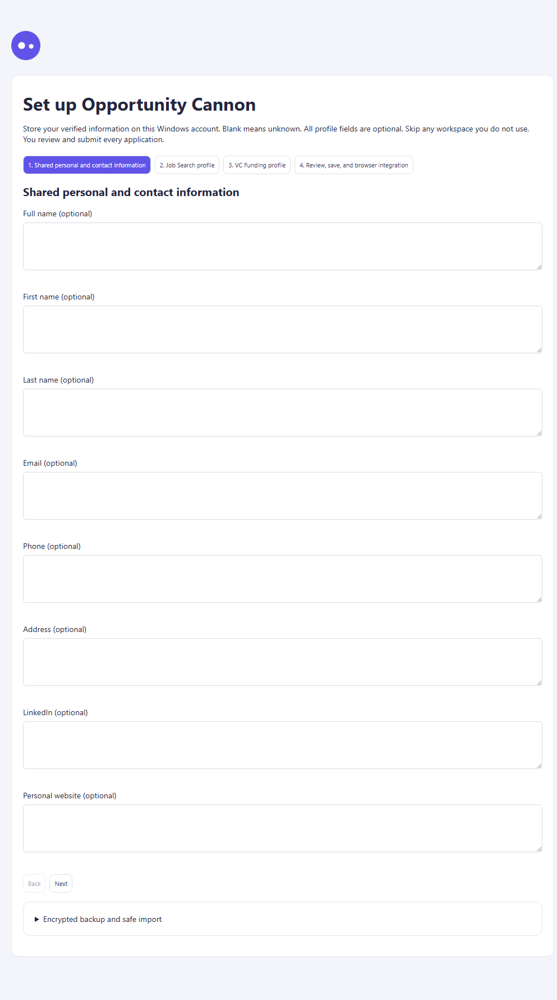
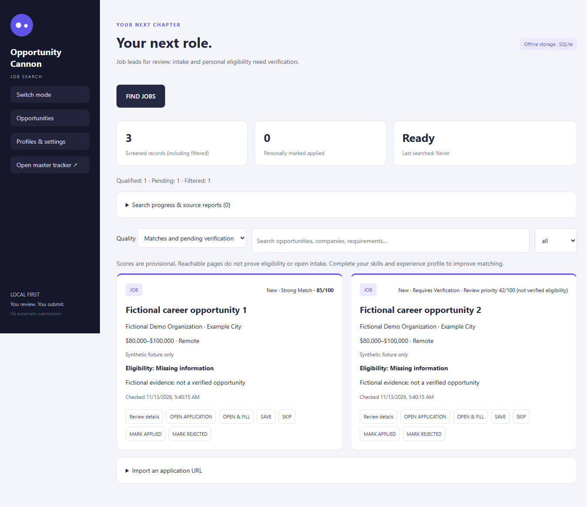
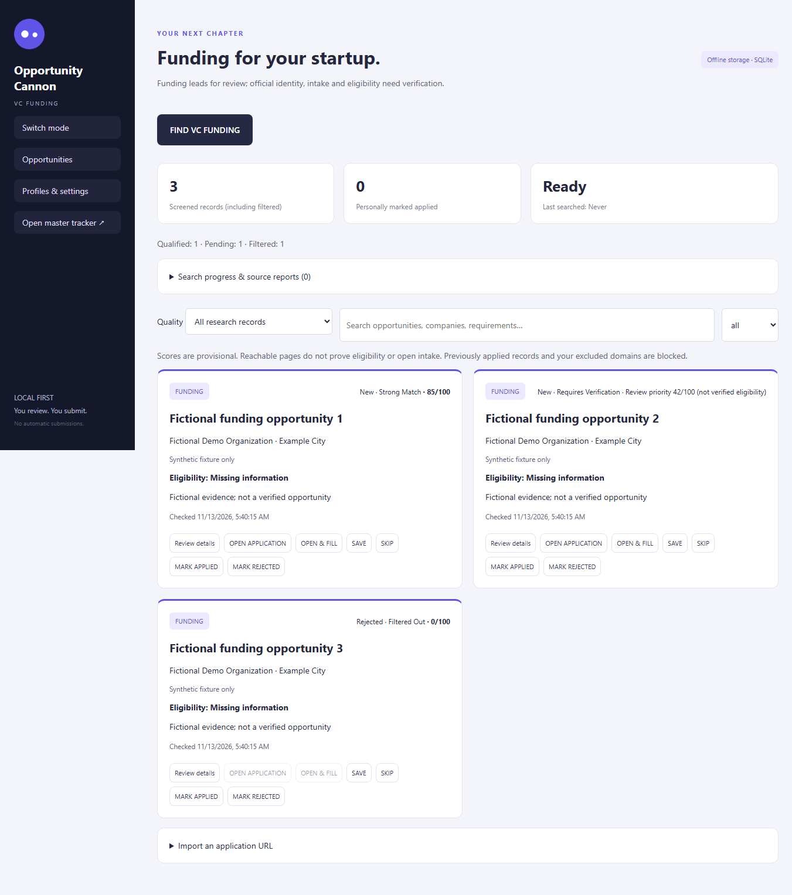
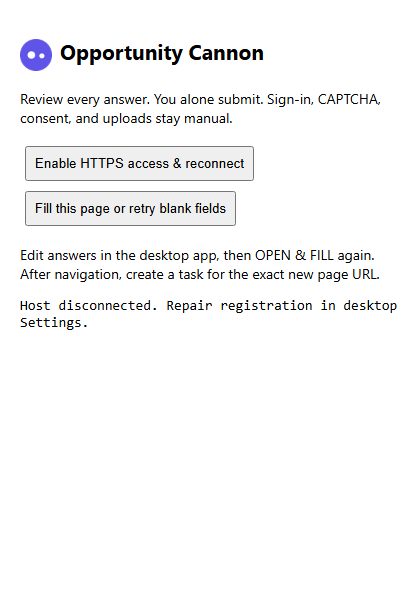

# Fictional demonstration

The desktop acceptance demo uses a newly created storage directory, the name **Fictional Demo**, `demo@example.test`, **Fictional Demo Organization**, and reserved `example.test` application URLs. The fixture opportunities are inserted locally to demonstrate the interface; they are not discovery results or real applications. Example salary values are synthetic.

On Windows after packaging:

```powershell
cd desktop
node tests/ui-final-acceptance.cjs "release-0.3.1/win-unpacked/Opportunity Cannon.exe"
```

The walkthrough captures fresh onboarding, both populated workspaces at five viewport sizes, filtering, details, notes, protected Rejected records, encrypted backup validation and merge, then restart persistence. Screenshots are generated under ignored `desktop/test-results/ui-final/`. Only reviewed PNGs are copied into this public documentation.

These are unedited captures from [the successful Windows run](https://github.com/NukeItGames/OpportunityCannon-Portfolio/actions/runs/43373241379), using the actual application extracted from its freshly built NSIS installer. The automated fixture does not submit applications or use personal accounts. Full-page captures include content beyond the visible viewport.

## Blank first launch

All contact fields begin empty. The wizard supports skipping either workspace.



## Review job opportunities

The demonstration seeds a Strong Match, a pending-verification lead, and a protected Rejected record. These classifications exercise the UI; they are not eligibility findings. Filter by quality/status, review details, write a fictional note, and save a record. The automated run checks dialog focus, Escape, note persistence, and protected opening behavior.



## Switch to funding

The VC workspace keeps funding records separate. The Rejected fixture shows disabled application-opening controls. The walkthrough then exports an encrypted backup, previews it, merges without overwriting existing records, and restarts to verify persistence. Native file-picker dialogs are stubbed in this automation.



## Inspect the browser helper

This is the real Edge extension page in its disconnected state. The UI and retry feedback were tested; this capture does not demonstrate a connected native host. Chrome did not load the extension through the tested command-line flags, so its popup remains untested.


